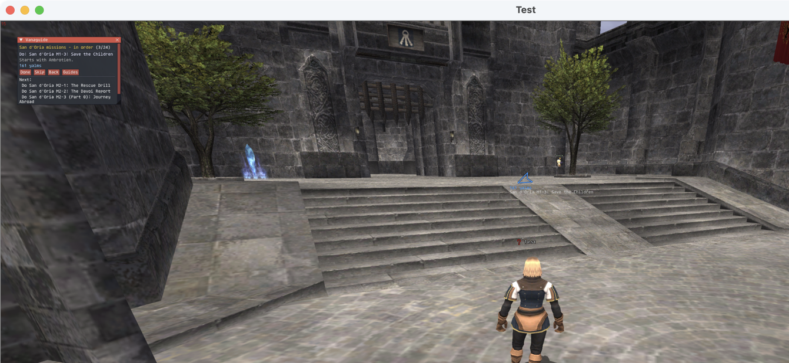

# What is proven, and what is not

The live-client evidence below was collected 2026-08-22 on a private LandSandBoat server. It is
historical and does not verify later quest-guide changes. Offline coverage was last rerun
2026-09-25; it is listed separately and must not be read as live gameplay evidence.

*Southern San d'Oria, character on a local LandSandBoat world: the guide window on step 3 of
24, the arrow in the world with the step under it, 161 yalms to the NPC who starts it.*

## Verified in the game

| | how |
| --- | --- |
| The addon loads | `/addon list` reports `Vanaguide 0.1.0 — State: Ok` |
| The guide window draws, with the step, the distance, the buttons and the next four steps | screenshot above |
| The arrow draws in the world, coloured, labelled with the step | screenshot above |
| `/vg guides` lists all 38 guides, numbered | in-game chat |
| `/vg load <n>` loads by number and reports the step it resumed on | in-game chat |
| **Quest and mission flags arrive and parse** — 28 `0x056` packets at login, all ten quest areas, the current mission of every storyline | `/vg story` |
| **A step completes itself when the server says so** — `!addmission 0 0` + `!completemission 0 0` on the live server moved the guide from step 1 to step 2 without touching the addon; completing mission 1 moved it to step 3 | `/vg status` before and after |
| Progress persists across a client restart | reloaded on the right step after a relaunch |
| `/vg find <item>` returns real vendors, prices, cities and quest sources | in-game chat |
| `/vg nm <name>` and `/vg track <n>` find a monster and make it the arrow's target | in-game chat |
| Position, zone and heading are read correctly | `/vg status` against known coordinates |
| The router's distance is right | 161 yalms to Ambrotien, matching the generated data |

## Five bugs the in-game run found, all fixed

1. **ImGui is a module, not a global.** `_G.imgui` is nil in Ashita v4; it is
   `require('imgui')`. The window and arrow silently never drew while every command worked.
2. **65535 means "no mission active", not "past every mission".** A fresh character reports
   it for every storyline, and `current > id` then marked all 24 San d'Oria missions
   complete — the guide jumped straight to the end. Now anything ≥ 65535 is "not started".
3. **Completed nation missions live on packet page `0x00D0`.** Completing a mission clears
   the current number back to 65535, so without this page a finished mission leaves no trace.
   Identified by watching bit 0 turn on after `!completemission 0 0`, then bits 0,1 after
   mission 1 — not from anyone's table.
4. **The horizontal axes are X and Y; Z is height.** Ashita's `position_t` names them
   X, Z, Y, and reading `.Z` as the second horizontal number made every distance wrong.
   Standing on the flat plaza reported Z = 0.0, which is the height.
5. **ImGui packs colour as `0xAABBGGRR`.** Written as ARGB, the "far" blue drew orange.

Plus two things that were not code: the FFXI chat font has no em dash (guide names printed
garbage — now plain hyphens), and `/addon load` placed **before** `/load Addons` in a boot
script is silently ignored, which is why `winecursor` did not load until the line moved below
the plugin block.

## Verified offline (2026-09-25)

The quest source generator now closes each input file after reading it; the focused extraction
tests pass with Python `ResourceWarning` promoted to an error (**2/2**). The guide checkout also
ignores Python bytecode/cache artifacts so generator tests do not surface `__pycache__` as source.

### Latest offline route verification (2026-09-25)

The current `luajit tools/test_offline.lua` run passes **1,831 assertions**. The A Squire's Test
fixture additionally checks that the Spook marker parses as x=2.9, z=-99.3, with the default
10-yalm arrival radius; it also verifies the route recommendation lands on that rounded point.
The Bastok M1-1 fixture checks that the Zeruhn Report and Naji turn-in arrows land at local SQL
positions Makarim (-60.92, -333.29) and Naji (66.9, -4.6); the route note records Rasmus's
fallback location. San d'Oria M1-1 checks Endracion's exact local `npc_list` x/z
(-112.82, -37.19) and zero-distance arrival. The read-only local SQL audit also checks selected
spawn rows for Ambrotien, Cleades, Cid, Balasiel, Janshura-Rashura, Hakkuru-Rinkuru, Apururu,
Pore-Ohre, Arnau, Endracion, and the Ghelsba Hut Door; offline guide fixtures pin these arrow
coordinates to those rows. San d'Oria M1-3 is derived from the mission script, battlefield
definition, and mission test. Its offline route check covers active-mission acceptance, the
manual Arnau briefing, Ghelsba battlefield checkpoint, Orcish Hut Key 157, manual Hut Door event,
return arrow, and mission-completion flag. Battlefield victory itself still requires live play.
Read-only local `xidb` checks confirm the marker for every authored `K` objective: Spook is level
11-13 at (2.9, -99.3); Orcish Fodder is level 3-4 at (-366.1, 215.3); the nearby level 3-5
Ding Bats are 0.3 yalms from the guide's rounded marker (-10, -89); and a level 3-4 Amber Quadav
is at (52, 60). The local `mob_droplist` entries confirm Revival Tree Root 15%, Orcish Axe 15%,
Orcish Mail Scales 10%, and each of the four Fetich pieces 25%. Offline assertions now hold all
four Fetich arrows to their shared local spawn coordinate and test the arrow distance there.
`zsh tools/audit_local_objective_markers.sh` makes this source check repeatable: it uses only the
local `xidb` Unix socket, filters placeholder spawn rows, requires four objective groups within
1 yalm of their marker, and asserts all seven expected mob/item drop entries at their exact rates.
Latest output was four groups at 0.00, 0.26, 0.03, and 0.01 yalms, with rates 25%, 10%, 15%,
and 15% as expected.
This is a local database audit, not a live server or player walkthrough.
The Squire's Test II
simulation now advances to the second marker, invokes the guide's `/vg back` state transition,
and verifies that the fixed first-marker checkpoint becomes active again, its arrow targets the
first marker, and manual confirmation returns to the second marker. This models the guide recovery
path after a timer expiry; it does **not** wait 30 seconds, trigger quest interactions, or verify
the local server/client timer live. The quest sequence still requires a player walkthrough on
local LandSandBoat.

`luajit tools/test_offline.lua` — **1,831 assertions passed**. In addition to parser, completion
conditions, mission flags, progress, routing, generated databases, and arrow rotation coverage,
the suite simulates the source-derived A Squire's Test, A Squire's Test II, and A Knight's Test
routes through level/prerequisite gates, acceptance flags, item objectives, travel, and quest-log
completion. It also checks quest-area aliases and generated external prerequisite gates. These
checks use local stubs and do not prove actual server packet behavior or player movement.
`python3 -m unittest tools/test_gen_quests.py` also passes the focused quest-header extraction
fixtures, including generation of multiple labeled header locations without changing the primary
quest-giver arrow target. These parser tests are not live-client verification.
For A Squire's Test, the authored item waypoint uses the local LSB `mob_spawn_points` row for
Spook in King Ranperre's Tomb at (2.9, -99.3, -0.6); item 940's 15% drop rate comes from the
local `mob_droplist`. A read-only check of the local `xidb` confirms this is the level 11-13 spawn.
The guide waits for the item inventory condition before routing back to Balasiel. Its local LSB
quest script has no level requirement, so the guide offers Balasiel immediately; the level 11-13
Spook is called out as a combat warning instead of an invented quest-acceptance gate. The offline
simulation verifies the first step remains available at level 1.
The A Knight's Test walkthrough also follows the local quest script's acceptance reward: it
waits for Book of Tasks key item 143 before routing to Baunise, then verifies the West/East books
(145/144) and Knight's Soul (146) before normal turn-in. Its offline simulation holds at this
new checkpoint until the key-item state arrives; the route still needs a natural player run.
The San d'Oria M1-1 walkthrough now follows server-backed mission acceptance (`MA`), the Orcish
Axe inventory objective, and the mission completion flag. Its item source and West Ronfaure
waypoint are drawn from the local LSB mission script and SQL; offline packet simulation verifies
the accepted mission id advances the guide and the completed flag closes the route. It has not
been naturally walked in a live client.
The Bastok and Windurst M1-1 guides are also derived from the local LSB mission scripts: the
Zeruhn Report key item (1) and Cracked Mana Orb (28) gate turn-ins, and mission 0 confirms
completion. Windurst's randomized target is represented as six sequential key-item checkpoints;
after a wrong gizmo, `/vg next` advances to the next marker, while acquiring the orb satisfies all
remaining checkpoints. Their NPC coordinates are copied from source comments and are not yet
confirmed by standing at them in-game. Route-specific offline simulations verify Bastok mission
acceptance, report-key-item progression, return routing, and completion; for Windurst they verify
mission acceptance, manual dialogue/gate checkpoints, skipping a wrong gizmo, all remaining gizmo
checkpoints clearing when the orb arrives, return routing, and completion. The current offline
harness also verifies Windurst M1-2 from the local LSB mission script: mission acceptance, Apururu's Dark Mana Orb, Pore-Ohre's Star Charm, manual confirmation of the six orb placements and gate interaction, all six glowing orbs, the East Sarutabaruta Cardian scene, return routing, and mission completion. Gizmo coordinates are copied from the local `npc_list.sql`; only the placement cluster marker is approximate. Placement and gate events cannot be inferred from the addon-visible mission log, so the player confirms each manually. The route represents the expected Cardian scene branch; players who avoid that zone-in scene should return directly to Apururu. This has not been naturally walked in a live client. The same offline harness
also verifies Bastok M1-2's two acidity tester key items, skipping a failed geyser, and
advancing after a successful alternative geyser. Its trigger coordinates come from the local LSB
zone script, and mission behavior is confirmed by its local server test. San d'Oria M1-2 is
source-derived from the mission script, mission test, and SQL: it waits for mission status to change
at the tombstone, then tracks item 1112 from the nearby local Ding Bat spawn before turn-in. Its
10% drop comes from the local droplist; offline route simulation checks the acceptance flag,
tombstone manual checkpoint, marker geometry, item gating, return, and completion. The current
The Bastok M1-3 walkthrough is derived from its local mission script and mission test. Offline
coverage verifies all four inventory conditions (item IDs 606-609), the Palborough Mines spawn
marker, return route, and completion flag. A local read-only SQL query links the items' 25% drop
entries to Amber Quadav in Palborough Mines. The current offline harness passes **1,831/1,831**.
The full `./scripts/test-addons.sh` suite passes with local-only guard **9/9**, VanaVoice **16/16**,
installer/tailer fixtures, and launcher addon policy **8/8**. These are offline checks; no client
or server was started in this verification.
The quest-packet simulation also verifies that a `QA` acceptance condition is satisfied by the
current-quest flag, remains satisfied after turn-in, and that turn-in clears the active flag while
setting the completed-quest flag.

Guide tags are validated strictly: unknown or duplicate tags and malformed numeric conditions
produce parse errors instead of silently disabling an authored completion trigger. The generator
combines multiple contextual notes into one parser tag, so prerequisite guidance remains intact.
Saved guide progress now includes a deterministic fingerprint of the step sequence and completion
conditions. A changed guide resets stale cursor/check/skip state; matching state resumes and
out-of-range cursors are clamped. This covers addon updates without pointing players at unrelated
steps; malformed saved cursors and mark maps are sanitized to safe defaults. This covers addon
updates without pointing players at unrelated steps; it does not establish live gameplay
persistence behavior beyond earlier visual observation.

The fixture-only local GM harness guard in `tools/test_local_guard.sh` passes **9/9**. Its
command-write cases verify that the safe writer revalidates the loader and LSB immediately before
each command append; hosted and unhealthy fixtures leave the command file empty. These tests use
mocked process/status output and do not launch or contact any server.

## Still not verified in game

1. **Quest completion packets.** Mission pages were observed live; a quest completion bit from
   the `Q` tag's page ids (`0x0090` and related pages) has not yet been watched turning on after
   naturally completing a quest. Offline flag simulation is not that evidence.
2. **The new sequential quest route.** No player has naturally accepted, followed the arrow to
   both timed cave markers, collected Stalactite Dew, returned to Balasiel, and turned the quest
   in on a live client. The source-derived route and quest-script match remain unverified in play.
3. **Cross-zone travel and zone-line learning.** No player has followed a route across a zone
   transition and verified the learned edge in a real session.
4. **`/vg mark` and arrow arrival.** No one has recorded a new marker and followed the resulting
   arrow all the way to its target.
5. **Speech alongside guide progress.** VanaVoice has separate historical live-client evidence;
   the current quest route has not been tested with narrated cutscenes on the same local session.
6. **Anything on a public server.** This was a private LandSandBoat world. See
   [SERVERS.md](SERVERS.md): Vanaguide is on no public server's allowlist and must not be tested
   against hosted servers.

## How this run was driven

The client cannot be typed into reliably from a script — Return opens the chat line only when
nothing is targeted, so a stray target turns every command into "Target out of range". The
addon therefore reads `addons/Vanaguide/cmd.txt` once a frame and runs each line, which is how
every command above was sent. Write a line, wait a second, screenshot. It executes only what a
player could type.
